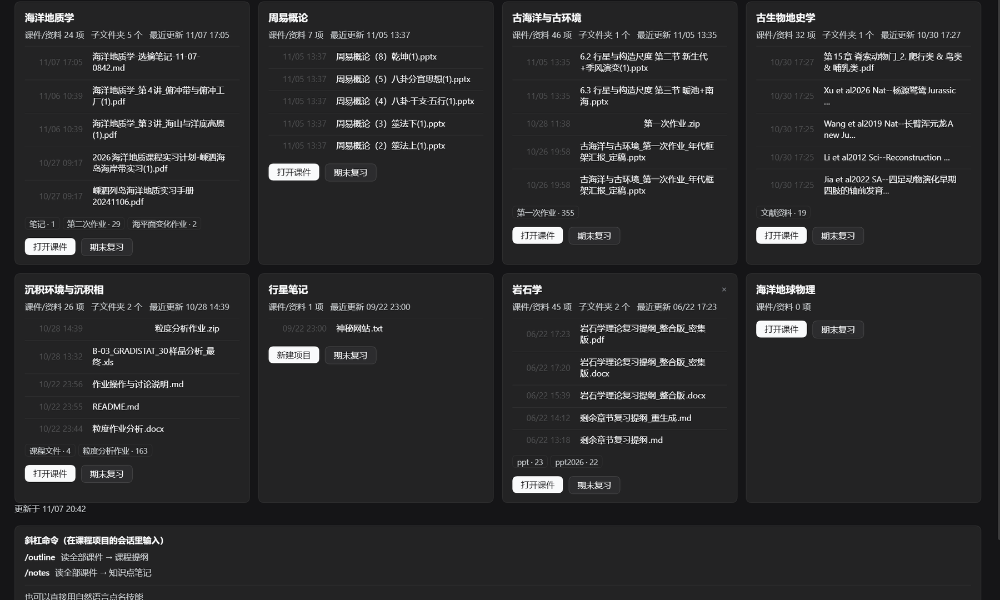
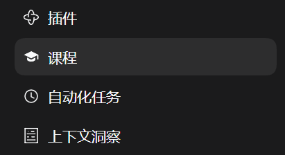

# 课程工作台（Tongji Course Workbench）

[English](README.md) · **简体中文**

[](https://github.com/yaoyikai8-png/dsh-course-workbench/actions/workflows/ci.yml)
[](LICENSE)
[](https://github.com/deepseek-ai)

一个 [DeepSeek Harness](https://github.com/deepseek-ai)（DSH）bundle：把「一个装满课件的文件夹」
变成一张学习台。侧边栏多一个「课程」面板，列出每门课的课件、更新时间和最新文件；再配
`/outline`、`/notes`、`/review` 三条命令和五个技能，读你的 `.pptx` / `.pdf` / `.docx` 课件，
把 Markdown + PDF 产物写回课程文件夹。

为同济大学海洋地质专业大三的课程写的，但代码里**没有任何课程相关的硬编码**——
指向任何「一个子文件夹 = 一门课」的目录都能用。



## 能做什么

| | |
|---|---|
| **课程面板** | 侧边栏毕业帽图标。卡片显示课件数、子文件夹数、最近更新时间和最新 5 个文件，点一下就进这门课。 |
| **按目录筛选** | 每加一个目录，网格上方就多一个可点的胶囊标签。点它只列这个目录下的课程，再点一次（或点「全部」）恢复。单独添加的课程始终可见。 |
| **勾选生成** | 进课程后逐份勾选要用的课件再生成——模型**只读勾选的那些**，不会把整个目录翻一遍。 |
| **期末复习** | 卡片上的「期末复习」按钮产出「总结 + **带完整解答的习题**」：课件里原有的题目、文件夹里能找到的往年试卷、以及预测题。 |
| **笔记视图** | 第二个标签页按课程分组列出所有已生成的产物，点一篇就在右侧栏打开预览。 |
| **每门课一个问答** | 会话名统一为 `课程名 笔记问答和期末复习`，所有笔记和复习都落在这一个会话里，第一次用时自动创建。 |
| **三条命令** | `/outline`、`/notes`、`/review`——不开面板也能跑同样的流程。 |

产物永远是 **Markdown + PDF**，放在 `<课程>/<课程名>笔记和复习/`。md 给右侧预览，pdf 拿去打印。

## 环境要求

- DSH，`desktop` profile（面板是客户端插件）。
- **Windows**：安装脚本和 PDF 工具链（PowerShell + Windows 字体）按 Windows 写的。
  面板和技能本身跨平台，但要自己改 `scripts/install.ps1`。
- Python 3.9+ 在 `PATH` 上（PDF 导出只需要 `fpdf2`，不装 LibreOffice，也不用 Word）。
- Node.js 20+（跑冒烟测试）。

## 安装

**不想碰命令行？** 去 [Releases](https://github.com/yaoyikai8-png/dsh-course-workbench/releases/latest)
下载 zip，解压，**双击 `install.bat`** 就行——它跑的就是下面这几步，装完窗口不会自动关，
方便你看结果。

会用 git 的话：

```powershell
git clone https://github.com/yaoyikai8-png/dsh-course-workbench.git
cd dsh-course-workbench
powershell -NoProfile -ExecutionPolicy Bypass -File scripts/install.ps1
```

这一步会把五个技能拷到 `~/.dsh/skills/`、转换器拷到 `~/.dsh/tools/md2pdf.py`、
把 `fpdf2` 装进 `~/.dsh/tools/pypdf`，最后跑一次真实的 md→pdf 自检。

然后用 DSH 的 plugin manager 注册面板（`target` 指向 clone 下来的目录）并启用。
**启用之前**先改 `cordis.patch.yml`，把 `courseRoot` 指向放课程的文件夹：

```yaml
- insert:
    - id: tongji-course-workbench
      name: 'tongji-course-workbench'
      config:
        courseRoot: 'D:\courses'   # 每个子文件夹 = 一门课
```

最后硬刷新页面（`Ctrl+Shift+R`），左侧边栏会出现 **课程** 这一项：



以后新加的课程文件夹也可以在面板里用 **＋ 新增项目** 直接选进来。

## 怎么用

1. **面板 → 课程卡片 → 打开课件**。这一步**只浏览文件**，不会建 DSH 项目，所以侧边栏的工作区列表不会因为你看一眼课件就变长。
2. **勾选文件 → 生成笔记**。真正要干活时才为这门课注册项目，Host 把这批确切路径交给它的会话。
3. **面板 →「笔记」标签**。所有产物按课程分组，点一下右侧预览。
4. 笔记右侧的 **提问** 会打开（或当场创建）这门课的问答会话，并把笔记钉在右侧栏。
5. 卡片上的 **期末复习** 流程一样，但要求的是完整复习材料，并把会话改名成
   `<课程名> 笔记问答和期末复习`。

### 三条命令

| 命令 | 产物 |
|---|---|
| `/outline` | 按讲次的课程提纲 + 从课件里翻出来的资料索引（参考文献、延伸阅读、图表出处） |
| `/notes` | 逐讲知识点笔记：定义、公式含义、易混点、考点标注 |
| `/review` | 期末复习：按板块重组的总结 + **带完整解答的习题** + 考点速查表 |

三条都接受补充要求，例如 `/review 只复习后六讲`。

## 五个技能

装在 `~/.dsh/skills/`，所有 DSH 会话可见：

| 技能 | 用途 |
|---|---|
| `course-outline` | 课程骨架 + 资料索引 |
| `course-notes` | 逐讲完整知识点笔记 |
| `course-review` | 期末复习 + 分题型习题与解答 |
| `course-digest` | 单讲课件 → 讲次笔记 + 目录索引 |
| `course-assignment` | 作业/实验报告：提纲 → 起草 → 成文 |

## PDF 是怎么来的

没有 LibreOffice，没有 Word，也不联网：`tools/md2pdf.py` 用 `fpdf2` 把 Markdown 排成 A4 PDF，
字体直接取系统的 `simhei.ttf`（缺字形时回退 `Deng.ttf`），中文不会变方块。

```powershell
python %USERPROFILE%\.dsh\tools\md2pdf.py 输入.md 输出.pdf --title "期末复习"
```

它只认一个刻意收窄的 Markdown 子集：标题、段落、有序/无序列表、表格、`**加粗**`、
行内代码、代码块、引用块。HTML、脚注、mermaid、图片语法会被原样当文字打出来，
所以技能里都避开这些写法。

## 实现结构

- `index.js` 是 Host 半边：`/dsh-course-workbench/*` 下的 HTTP 路由（overview、预览队列、
  generate、笔记问答映射、diagnostics、selftest）+ 三条斜杠命令。
- `client.js` 是 Web 半边：一个侧边栏入口 + 一个面板，通过 `ctx.slots.register` 渲染。
  它自己**不碰文件系统**——只把勾选的文件清单 POST 给 Host，由 Host 转给对应的会话。
- 产物路径是**算好之后写进提示词**的绝对路径，所以模型不会把文件写到别处；
  md 一出现，右侧预览就自动打开。

## 开发

```powershell
npm run check     # 两个半边语法检查 + 无头冒烟测试
npm test          # 只跑冒烟测试
```

`smoke-client.mjs` 桩掉 React 和 Cordis 客户端上下文，把面板渲染两遍（loading / 有数据），
点一遍标签页、复习视图和笔记问答流程，断言提示词内容和右栏资源地址。

## 已知限制

- 偏 Windows：安装脚本、技能说明和字体路径都按 Windows 写的。
- PDF 排版器是刻意做小的，多栏、浮动图这类复杂版式不支持。
- 课件靠 DSH 的 `office-*` 技能读取；没有文字层的扫描版 PDF 会被标成「未提取」而不是猜内容。
- 面板假定「一个课程文件夹 = 一个 DSH 项目」。

## 许可

[MIT](LICENSE)
